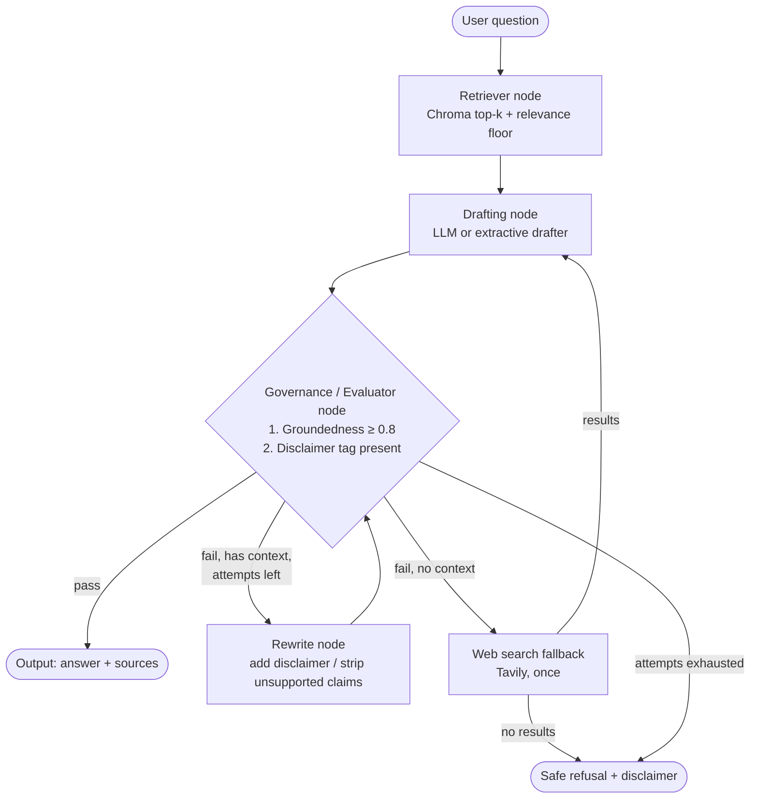
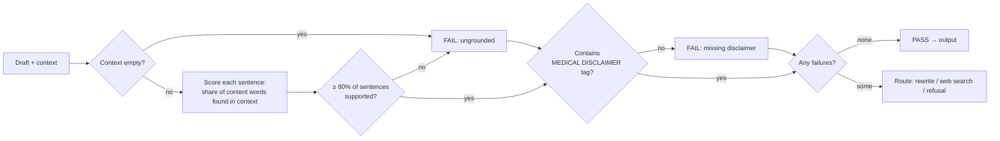
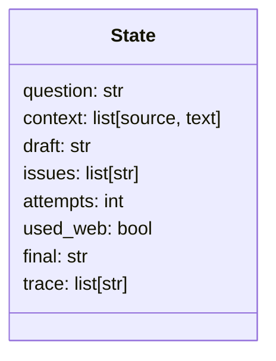
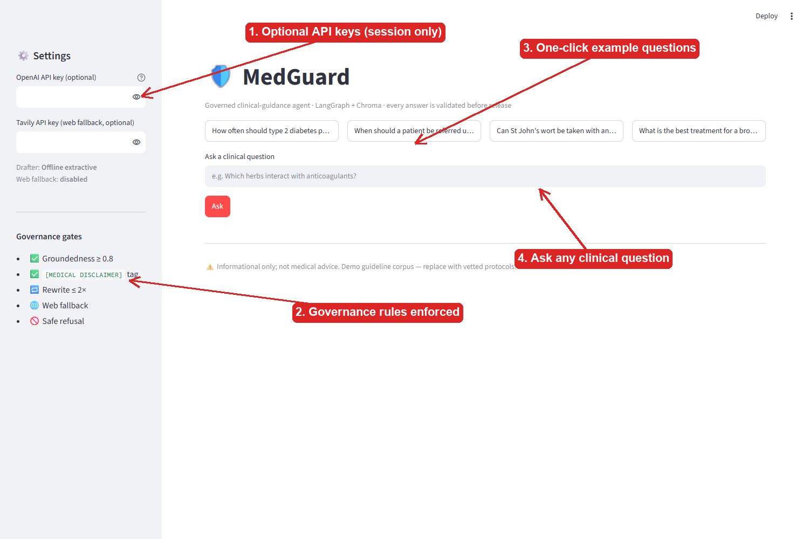
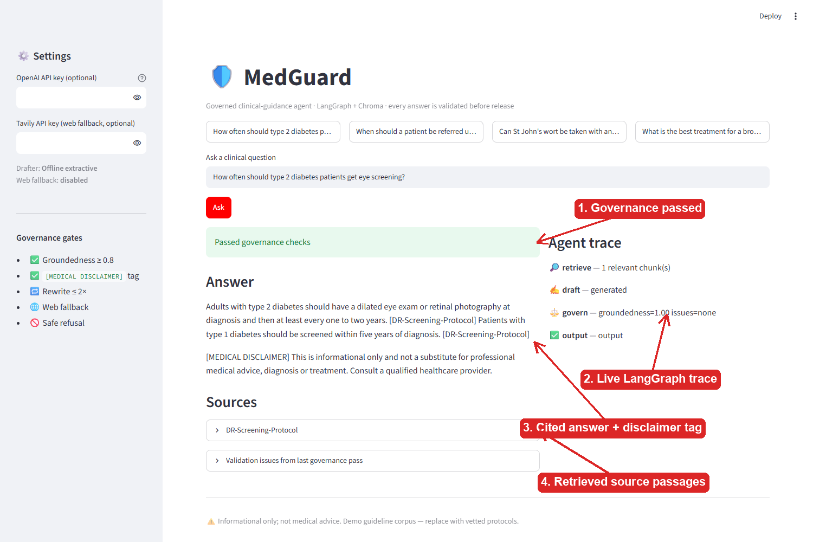
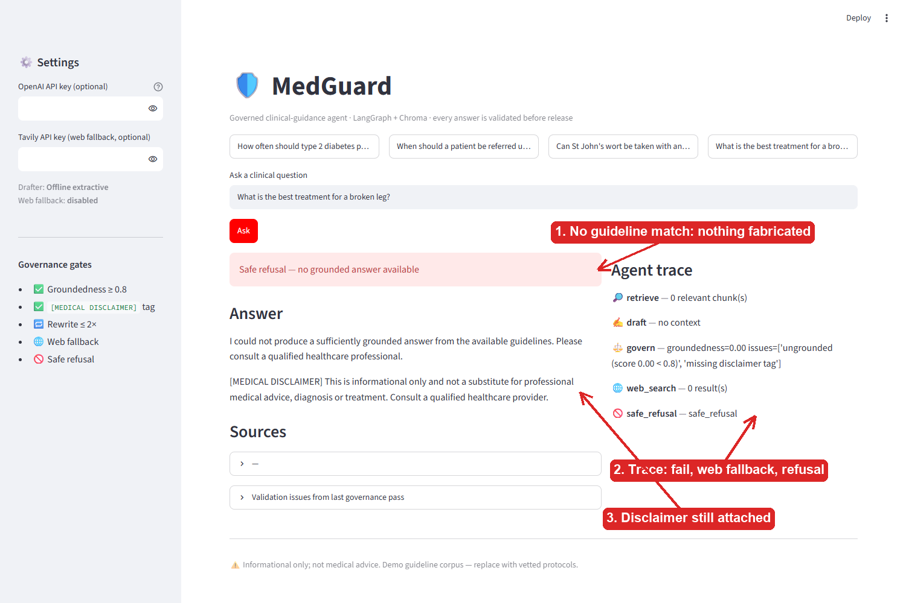

# 🛡️ MedGuard — Stateful Clinical Protocol Assistant with Technical Governance

A LangGraph agent that never returns raw LLM output. Every answer is retrieved from a Chroma
knowledge base of clinical guidance, drafted, then **validated for groundedness and mandatory
medical disclaimers** before release. Failures loop back to rewrite, fall back to web search,
or end in a safe refusal.

## Architecture



### Governance decision logic



### Shared graph state



## UI walkthrough

### 1. Home screen


1. **Optional API keys** – OpenAI (LLM drafting) and Tavily (web fallback); kept in session memory only.
2. **Governance rules** – the gates every answer must clear.
3. **Example questions** – one click fills the question box (includes an out-of-scope probe).
4. **Question box** – type any clinical question and press *Ask*.

### 2. Grounded answer (governance passes)


1. **Status banner** – green: groundedness and disclaimer checks passed.
2. **Live agent trace** – each LangGraph node as it runs (retrieve → draft → govern → output).
3. **Answer** – cited sentences from the guideline plus the mandatory `[MEDICAL DISCLAIMER]` tag.
4. **Sources** – the exact retrieved passages, expandable for audit.

### 3. Safe refusal (out of scope)


1. **Red banner** – no guideline matched, so nothing is fabricated.
2. **Trace** – retrieve found nothing → governance failed → web fallback attempted → refusal.
3. **Answer** – a refusal that still carries the disclaimer.

## Quick start

```bash
pip install langgraph langchain-openai langchain-tavily chromadb streamlit
streamlit run app.py          # web UI
python medguard.py "How often should type 2 diabetics get eye screening?"   # CLI
```

Optional environment variables: `OPENAI_API_KEY`, `TAVILY_API_KEY`, `MEDGUARD_MODEL` (default `gpt-4o-mini`).
Without keys it runs offline with a deterministic extractive drafter.

Regenerate screenshots: `pip install playwright pillow && python docs/make_screenshots.py`

## Files

| File | Purpose |
|---|---|
| `medguard.py` | Graph, nodes, governance and routing |
| `guidelines.py` | Demo guideline corpus (replace with vetted protocols) |
| `app.py` | Streamlit UI |
| `docs/make_screenshots.py` | Captures and annotates UI screenshots |

> ⚠️ Informational only; not medical advice. The bundled corpus is a paraphrased demo.
